# 🐤 Pixel Chick

**A rechargeable keychain / bag charm with a living pixel face.**
An Arduino Pro Mini drives a tiny 0.96" OLED screen inside a 3D-printed chick. It blinks, looks around, changes its mood every few seconds and now and then shows a short love note. When nobody moves it, it goes to sleep and draws only a few microamps. A shake or a button press wakes it up again.

I made it as a gift for my girlfriend. The parts cost a few dollars, and the case was printed at a local print shop.

<p align="center">
  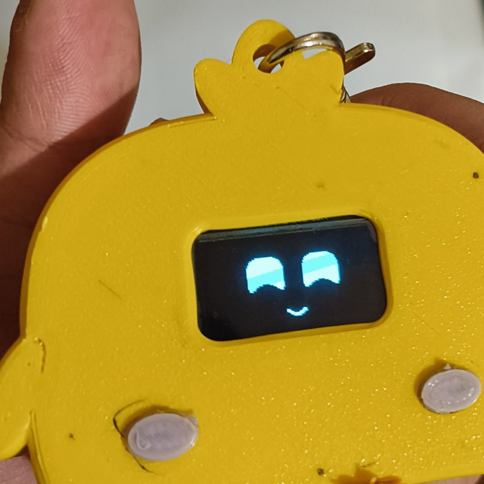
  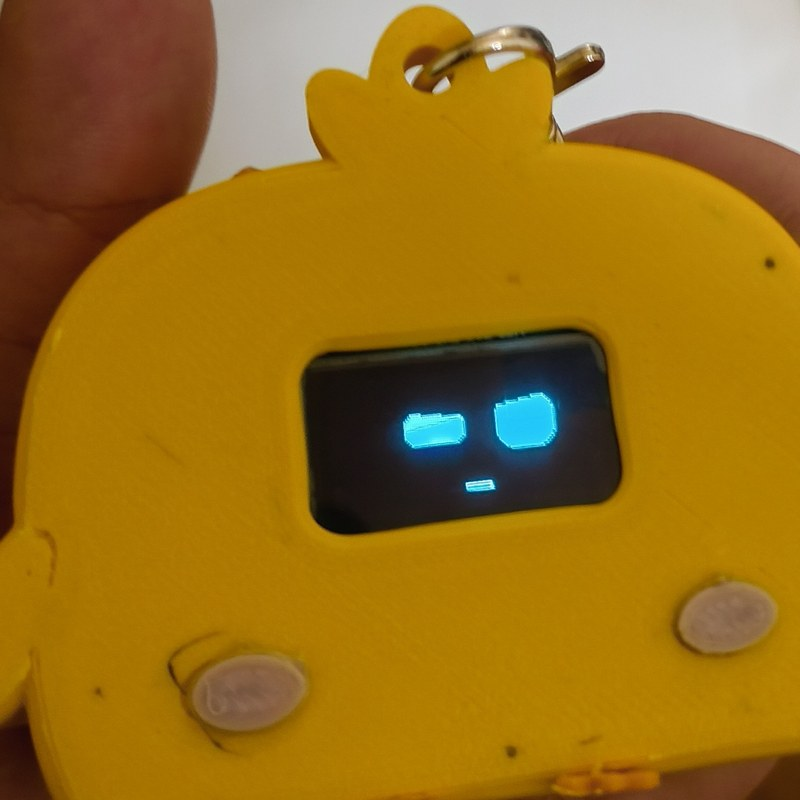
  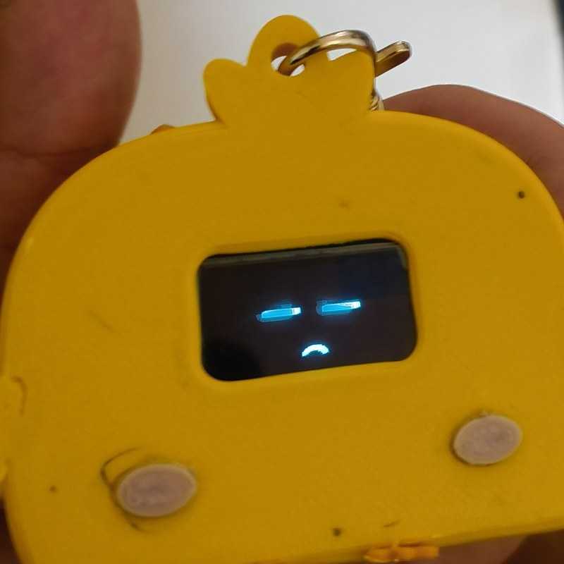<br>
  <em>The finished chick: happy, suspicious, grumpy</em>
</p>

<p align="center">
  <br>
  <em>The face as it runs on the OLED (rendered from the firmware on a PC)</em>
</p>

<p align="center">
  
  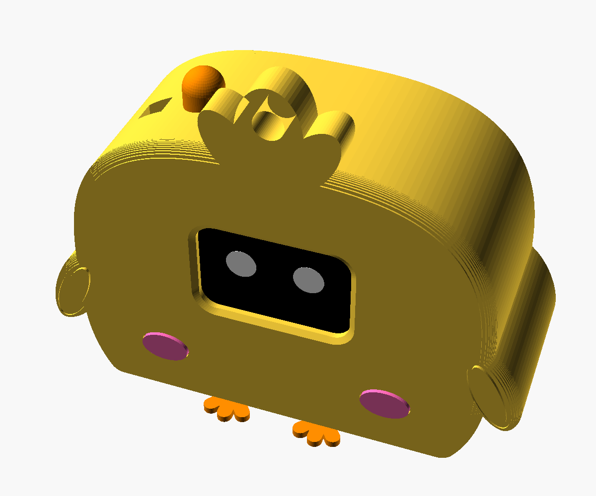
  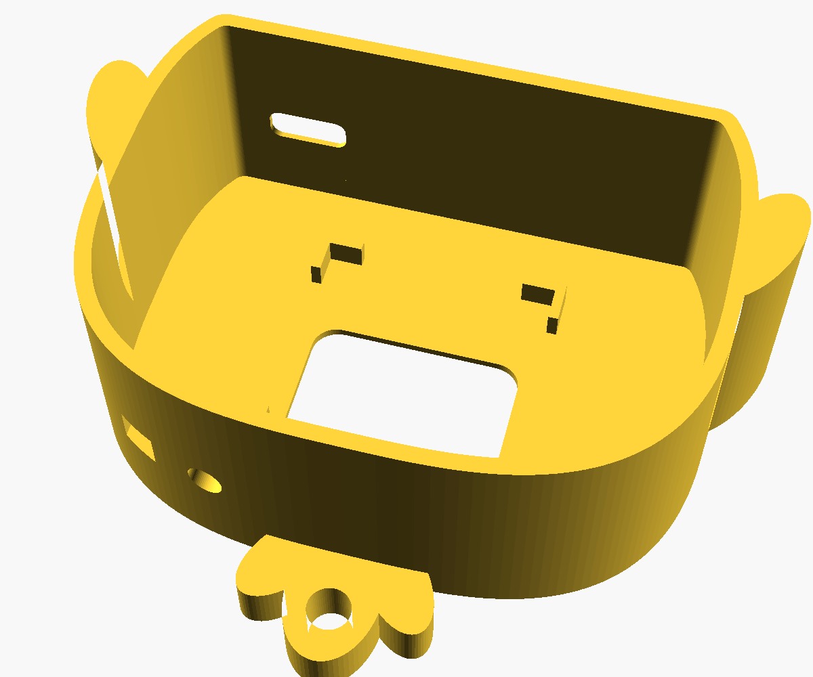<br>
  <em>OpenSCAD renders of the case</em>
</p>

---

## Contents

1. [Features](#features)
2. [Parts list](#parts-list)
3. [Tools](#tools)
4. [Wiring overview](#wiring-overview)
5. [Build guide: what is soldered where](#build-guide-what-is-soldered-where)
6. [Programming](#programming)
7. [Customising](#customising)
8. [The 3D-printed case](#the-3d-printed-case)
9. [Final assembly](#final-assembly)
10. [Battery life](#battery-life)
11. [Troubleshooting and lessons learned](#troubleshooting-and-lessons-learned)
12. [Repository layout](#repository-layout)

---

## Features

<p align="center">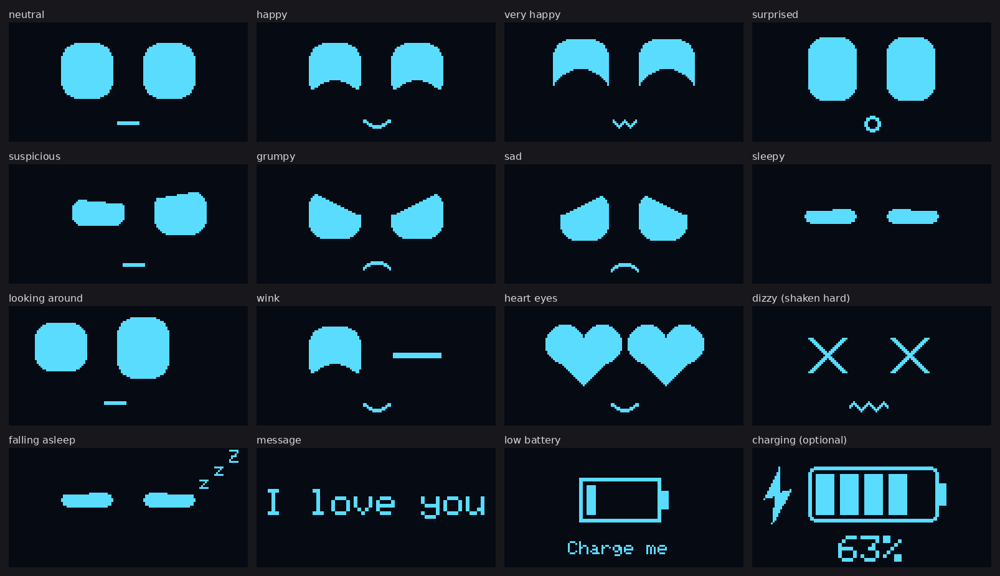</p>

- **8 expressions** that blend smoothly into each other: neutral, happy, very happy, surprised, suspicious, grumpy, sad and sleepy. There are also **heart eyes** and a **wink**.
- **Personal messages.** Five short notes of your own appear now and then.
- **Wakes on movement.** When the bag moves, the chick looks surprised and then smiles.
- **Gets dizzy.** Shake it hard and the eyes turn into X X.
- **Deep sleep.** After 30 s without movement it yawns ("zzz"), switches the screen's charge pump off and puts the ATmega328P into power-down sleep.
- **Push button.**
  - A short press shows a new expression right away.
  - Holding it for 1.5 s toggles **Always on** / **Auto sleep**. The setting is saved in EEPROM.
- **Battery aware.**
  - The chick measures its own supply voltage against the internal 1.1 V reference, so no extra parts are needed.
  - It warns when the battery is low. When the battery is empty it only shows "Charge me".
- **USB-C charging.** A TP4056 module charges the battery and protects it.
- **Walking protection.** If it keeps moving for 3 minutes (for example while you walk), it goes back to sleep and ignores movement for 10 minutes. The button still works during that time.

---

## Parts list

<p align="center">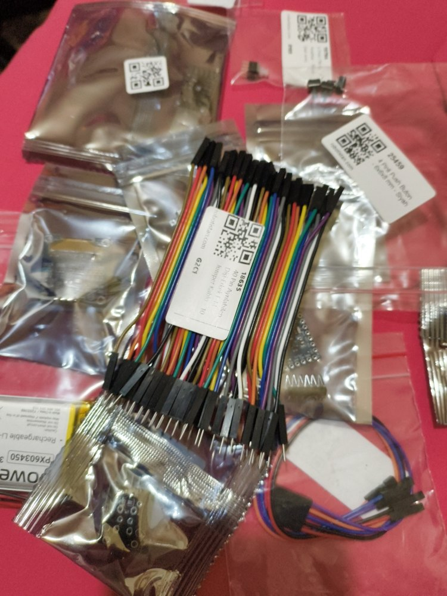</p>

| # | Part | Notes |
|---|------|-------|
| 1 | **Arduino Pro Mini 3.3 V / 8 MHz** (ATmega328P) | It must be the **3.3 V** version, because the 5 V/16 MHz version is not stable on a LiPo. Buying 2 is a good idea, in case you damage one while soldering. |
| 1 | **0.96" I2C OLED, SSD1306, 128×64** | 4 pins: VCC GND SCL SDA. I used a white one. |
| 1 | **TP4056 Type-C charger module *with protection*** | The version with 6 pads (OUT+ B+ B− OUT−). The protected module has an extra DW01 chip and a dual MOSFET on board. |
| 1 | **LiPo 3.7 V 1000 mAh**, Power-Xtra PX603450 (6 × 34 × 50 mm) | It came without a connector. Any protected 1S LiPo of up to about 6 × 35 × 55 mm fits the case. |
| 1 | **KY-002 vibration (spring) sensor module** | Buy 2, because their sensitivity differs a lot (see [troubleshooting](#troubleshooting-and-lessons-learned)). |
| 1 | **6 × 6 × 8 mm tactile push button** | This is the expression button. |
| 1 | **6-pin self-locking push switch** (latching ON/OFF) | This is the main power switch. |
| 1 | **100 nF ceramic capacitor** (marked "104") | It is required for waking from sleep, see below. |
| 1 | **CP2102 USB-TTL adapter (6-pin, with DTR)** | It is needed only for programming. Because it has DTR, uploads work without pressing reset. |
| – | Jumper wires (F-M, 10 cm) + a 5-pin F-F jumper | I used the wires themselves and cut the plastic housings off where needed. |
| – | Heat-shrink tube, electrical tape, hot glue, super glue | These are for insulating the joints and fixing the parts inside the case. |

---

## Tools

- A soldering iron and solder.
- A multimeter. A Fluke T5 was enough: you need continuity (beep) and DC volts.
- A side cutter or wire stripper.
- A hot-glue gun.
- A PC with the Arduino IDE.

---

## Wiring overview

<p align="center">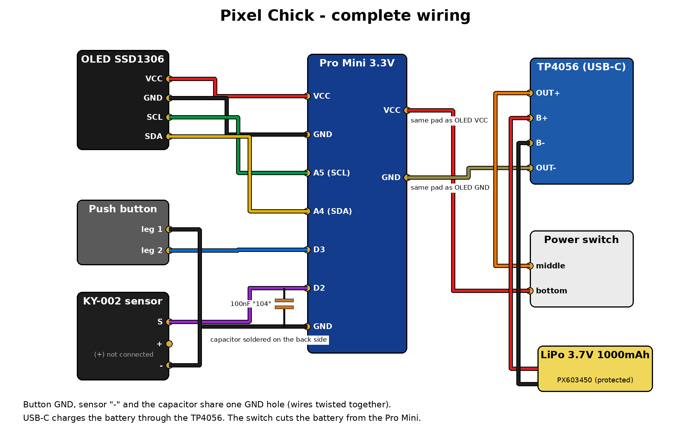</p>

| From | To | Wire colour in my build |
|------|----|-------------------------|
| OLED **VCC** | Pro Mini **VCC** | red |
| OLED **GND** | Pro Mini **GND** | black |
| OLED **SDA** | Pro Mini **A4** | yellow |
| OLED **SCL** | Pro Mini **A5** | green |
| Button leg 1 | Pro Mini **GND** | black |
| Button leg 2 (diagonal to leg 1) | Pro Mini **D3** | blue |
| KY-002 **S** | Pro Mini **D2** | purple |
| KY-002 **−** | Pro Mini **GND** (same hole as the button GND) | black |
| KY-002 **+** | *not connected* | – |
| 100 nF capacitor | between **D2** and **GND** (back side) | – |
| Battery red | TP4056 **B+** | red |
| Battery black | TP4056 **B−** | black |
| TP4056 **OUT+** | power switch **middle** leg | red ("Red 1") |
| Power switch **bottom** leg | Pro Mini **VCC** | red ("Red 2") |
| TP4056 **OUT−** | Pro Mini **GND** | khaki |
| *(optional)* TP4056 red CHRG LED | Pro Mini **D4** | not wired in my build |

The Pro Mini's **RAW** pin is not used. The battery feeds **VCC** directly, which bypasses the on-board regulator. A charged LiPo gives 3.0 to 4.2 V, which the ATmega328P at 8 MHz and the SSD1306 module both handle well.

---

## Build guide: what is soldered where

The steps are in the order I did them, and each step was tested before moving on. The pictures are from my actual build.

### Step 1: Programming header

Solder the 6-pin **right-angle** header into the six holes on the short edge of the Pro Mini (GRN, TXO, RXI, VCC, GND, BLK). This is the only header on the board. Everything else is soldered directly to wires.

<p align="center">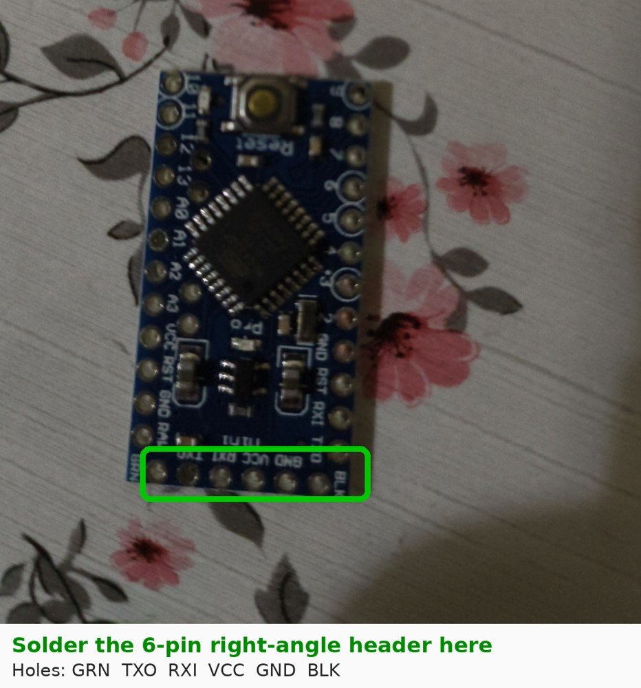</p>

### Step 2: Connect the CP2102 and upload Blink

Use the 5-pin female-female jumper. **TX goes to RX** and **RX goes to TX**:

| CP2102 | Pro Mini | Wire (mine) |
|--------|----------|-------------|
| DTR | GRN | red |
| RXD | TXO | black |
| TXD | RXI | blue |
| 3V3 | VCC | orange |
| GND | GND | purple |

The CP2102's **+5V** and the Pro Mini's **BLK** are left empty. **Never** use the 5 V pin on a 3.3 V board.

<p align="center">
  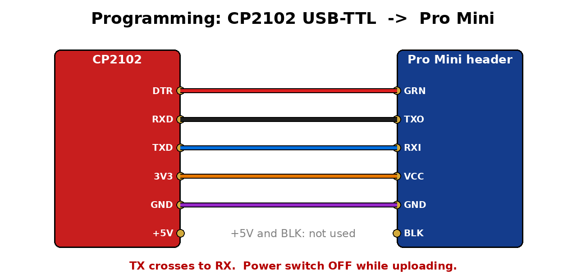<br>
  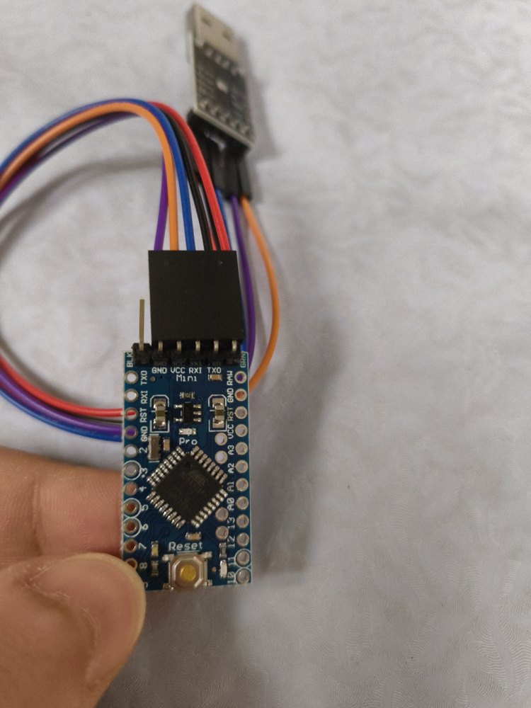
</p>

Upload *File → Examples → 01.Basics → Blink* (see [Programming](#programming)). The LED next to pin 13 should start blinking. That shows the board, the driver and the cable all work.

### Step 3: OLED → Pro Mini

The OLED's pins, from left to right, are **VCC GND SCL SDA**. Check the print on your module, because some modules swap VCC and GND.

The four wires go into holes on the Pro Mini's long edge. A4 and A5 are the two **inner** holes near the corner, not on the edge. Turn the board over to read their labels.

<p align="center">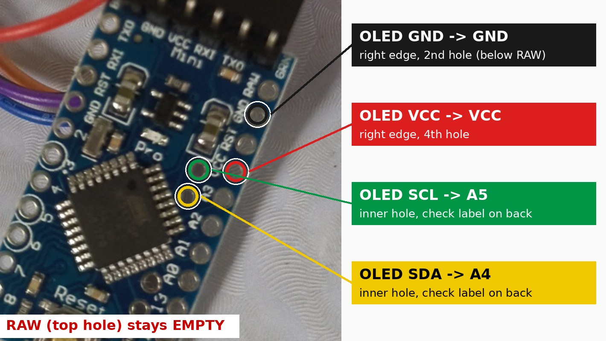</p>

| OLED | Pro Mini |
|------|----------|
| VCC | VCC |
| GND | GND (the hole just below RAW) |
| SCL | A5 |
| SDA | A4 |

Now flash the Pixel Chick firmware with `DESK_TEST 1` (see [Programming](#programming)). The face should appear:

<p align="center">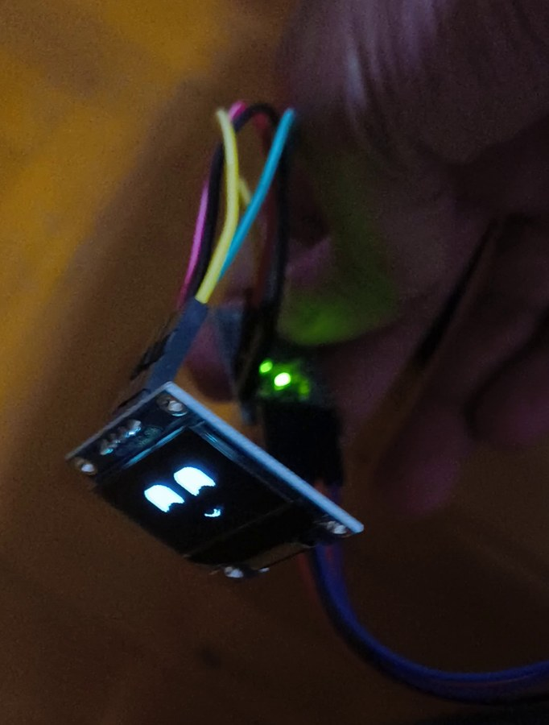</p>

### Step 4: Button and vibration sensor

**Button.** A 6 × 6 tactile switch has 4 legs, but only two of them are needed: two legs that sit **diagonally** across from each other. Diagonal legs are always on opposite sides of the switch, so the button works no matter which way it is turned.
- One leg is wired to **D3** (blue).
- The other leg is wired to **GND** (black).

I cut the plastic housing off the jumper wires, soldered the wires directly to the legs, and covered each joint with heat-shrink tube.

**KY-002 sensor.** It has three pins.
- **S** goes to **D2** (purple).
- **−** goes to **GND** (black).
- The middle **+** pin is left unconnected. The firmware uses the ATmega's internal pull-up instead, which uses less power.

On the Pro Mini edge, the holes **3**, **2** and **GND** are next to each other. The two black GND wires from the button and the sensor are twisted together and soldered into the **same** GND hole.

<p align="center">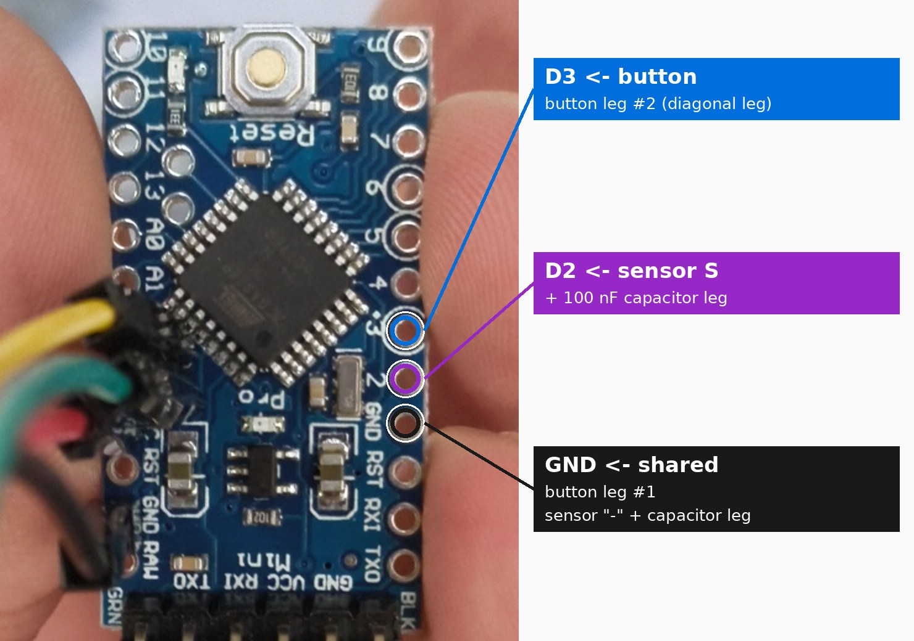</p>

### Step 5: The 100 nF capacitor (D2 to GND)

On the **back** of the board, solder a 100 nF ceramic capacitor (marked "104") across the D2 joint and the GND joint. Cut its legs short.

<p align="center">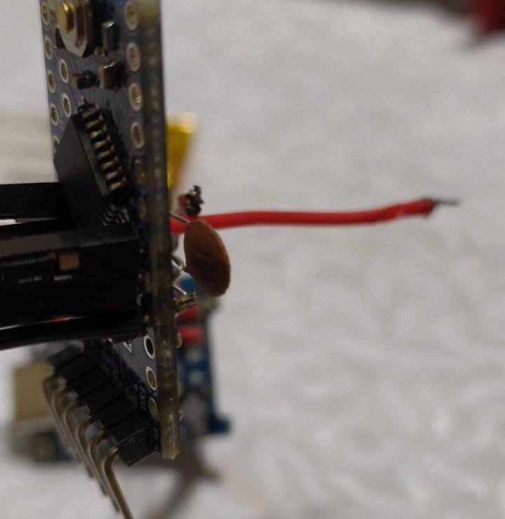</p>

The capacitor is needed because the spring sensor only touches for a few microseconds. That is enough to show up while the board is awake, but too short to reliably wake an ATmega328P from power-down sleep. The capacitor stretches each contact into a pulse long enough for the pin-change interrupt to catch.

Without the capacitor, the chick woke up from the button but **not** from shaking.

### Step 6: Battery → TP4056

The TP4056 has four pads along its top edge, in this order: **OUT+, B+, B−, OUT−**.
- Solder the battery's **red** wire to **B+** and its **black** wire to **B−**.
- The small **+ / −** pads next to the USB connector are **not** used.

<p align="center">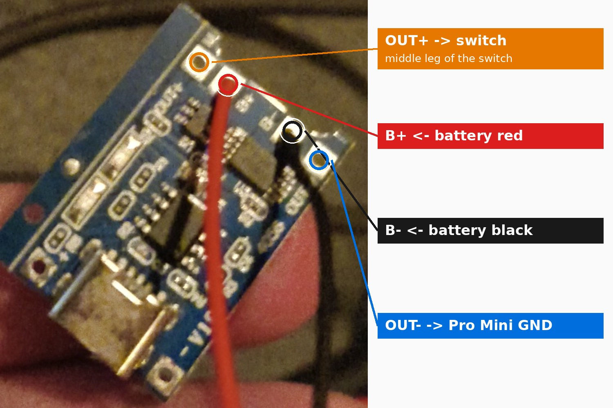</p>

> ⚠️ **Check the battery's polarity before soldering.** Do not let the two battery wires touch. Pre-tin the pads first, then hold each wire on its pad for only a second or two, so the heat does not reach the battery.

Test: measure between OUT+ and OUT−. You should read the battery voltage, about 3.7 to 4.2 V.

### Step 7: Power switch

The self-locking switch has two rows of three legs. Only **one row** is used:
- **middle** leg ← wire from TP4056 **OUT+** ("Red 1")
- **bottom** leg → wire to Pro Mini **VCC** ("Red 2")

Before soldering, check with the multimeter's continuity (beep) mode: the middle and bottom legs should beep **only when the switch is pressed in (ON)**.

<p align="center">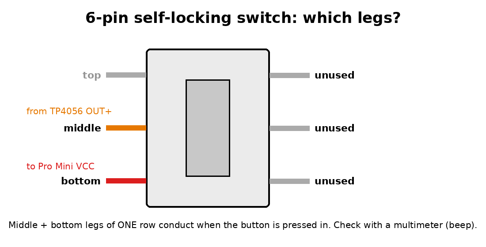</p>

### Step 8: Power wires → Pro Mini (back side)

On the **back** of the Pro Mini, the battery power joins the OLED's power joints:
- **Red 2** (from the switch) goes to the **VCC** pad, the same joint as the OLED VCC wire.
- The khaki wire from TP4056 **OUT−** goes to the **GND** pad, the same joint as the OLED GND wire.
- **RAW** stays empty.

<p align="center">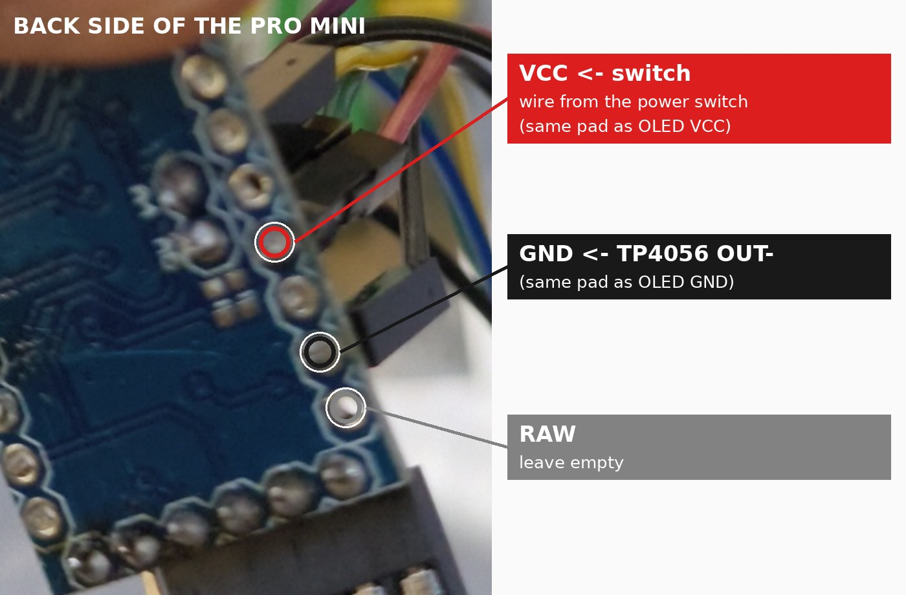</p>

> It is fine to put two wires in one hole. Twist them together, push both through, and solder them as a single joint.

### Step 9: Test everything on battery

1. Disconnect the CP2102.
2. Press the power switch in. The green power LED on the Pro Mini lights up and the face appears.
3. Press the button. The expression changes.
4. Wait 30 seconds. The chick yawns and the screen goes off.
5. Press the button, then shake the chick. It wakes up both times.
6. Plug in USB-C. The red LED on the TP4056 means it is charging. The blue LED means the battery is full.

<p align="center">
  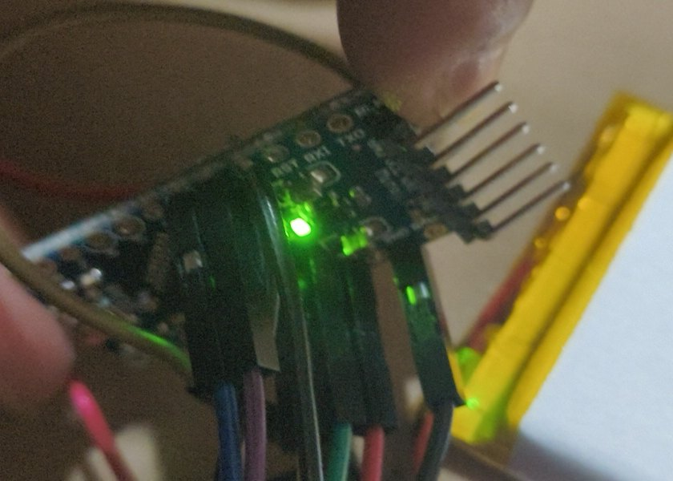
  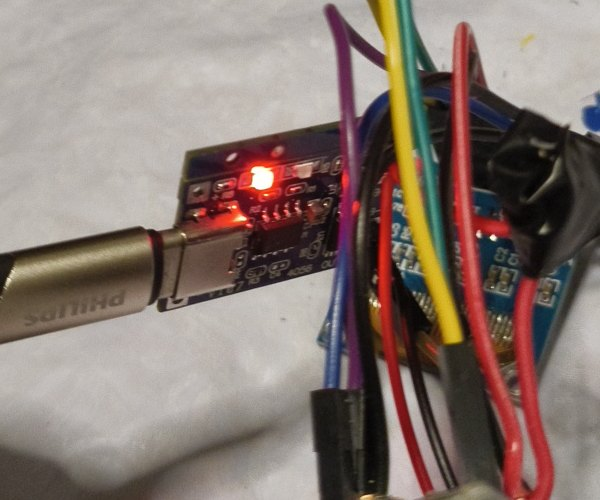
</p>

<p align="center">
  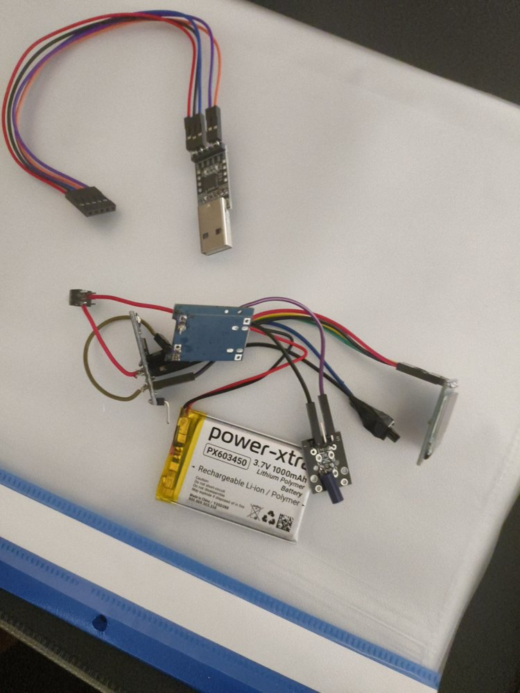<br>
  <em>All electronics wired and working, before going into the case</em>
</p>

### Optional: Charging screen (D4)

The firmware can show a charging screen (battery icon with "63%", then "Full &lt;3"). To use it, solder a thin wire from the **CHRG side of the TP4056's red LED** to **D4**. The CHRG side is the LED leg that does *not* go to VCC; it is LOW while charging. Find it with a multimeter while the battery is still charging, because once the battery is full you cannot tell which leg is which.

If D4 is not wired, nothing breaks; the charging screen simply never appears. I skipped it in my build.

---

## Programming

1. Install the **Arduino IDE** and the **CP2102 driver** (Silicon Labs "CP210x VCP" driver). On Windows the adapter then shows up as a COM port, for example COM3.
2. Open *Tools → Manage Libraries*, install **Adafruit SSD1306**, and accept its dependencies (Adafruit GFX and Adafruit BusIO).
3. Open `firmware/pixel_chick/pixel_chick.ino`.
4. Use these settings:
   - *Tools → Board*: **Arduino Pro or Pro Mini**
   - *Tools → Processor*: **ATmega328P (3.3V, 8 MHz)**
   - *Tools → Port*: the CP2102's COM port
5. Click **Upload**.

> 🔌 Keep the **battery switch OFF** while the CP2102 is connected, so two power sources never feed VCC at the same time.

**Desk testing.** While the board runs from the CP2102's 3.3 V, the battery check sees a "low" voltage and would only show "Charge me". To avoid that, set `#define DESK_TEST 1` while testing on the desk. Set it back to `0` before running on the battery.

The firmware uses about 26.7 kB of flash (81 %) and about 640 B of RAM.

---

## Customising

All settings are at the top of `pixel_chick.ino`.

**Messages.** Change the five messages to your own:

```cpp
const char m0[] PROGMEM = "I love you";
const char m1[] PROGMEM = "So glad you exist";
const char m2[] PROGMEM = "You look great today";
const char m3[] PROGMEM = "Smile :)";
const char m4[] PROGMEM = "<3";
```

Each message can be up to about 45 characters, and the text is word-wrapped and centred on the screen. Turkish letters (ç ğ ı İ ö ş ü) are allowed; they are shown without their accents.

**How often each face appears.** Change the weights. A bigger number makes a face appear more often, and 0 means never:

```cpp
//           NEUTRAL HAPPY V_HAPPY SURPRISED SUSPICIOUS GRUMPY SAD SLEEPY HEART WINK MESSAGE
WEIGHTS = {     22,    18,     9,       7,         7,       5,   4,     4,    8,    8,     8 };
```

**Behaviour settings:**

| Setting | Default | Meaning |
|---------|---------|---------|
| `AWAKE_MS` | 30000 | Goes to sleep after this many ms without movement |
| `MAX_AWAKE_MS` | 180000 | Maximum awake time while it keeps moving |
| `COOLDOWN_MS` | 600000 | After that maximum, movement is ignored for this long |
| `WAKE_SHAKES` | 1 | Shakes needed to wake up. Use 2 if it wakes too easily |
| `DIZZY_SHAKES` | 8 | Shakes within 1 s needed to make it dizzy |
| `DEBOUNCE_MS` | 40 | The spring chatters, so pulses within this window count as one shake |
| `CONTRAST` | 40 | Screen brightness from 0 to 255. Lower means longer battery life |
| `BATT_WARN_MV` / `BATT_EMPTY_MV` | 3450 / 3300 | Battery thresholds in mV |
| `VCC_CONSTANT` | 1125300 | Voltage calibration: `1.1 V × 1023 × 1000`. Adjust it if the voltage reading is off compared with your multimeter |

---

## The 3D-printed case

<p align="center"></p>

The case is a chubby chick with a tuft on top (which has the keyring hole), little wings, pink cheeks and orange feet. The screen looks out through the chick's belly as its face.
- The **button** and the **power switch** come out of the top of the head.
- The **USB-C** port is on the flat bottom.
- The lid snaps into the back.
- The **screen window** is sized to the display glass only (about 25 × 16 mm), so the module's PCB edges stay hidden and only the black glass shows.

It is designed in OpenSCAD, in `case/pixel_chick_case.scad`. Ready-made STLs are in `case/stl/`.

| File | Colour | Qty | Size (mm) |
|------|--------|-----|-----------|
| `body.stl` | yellow | 1 | 80 × 65 × 28 |
| `lid.stl` | yellow | 1 | 80 × 53 × 4 |
| `foot.stl` | orange | 2 (+1 spare) | tiny |
| `cap.stl` | orange | 1 (+1 spare) | button cap |
| `cheek.stl` | pink | 2 | tiny |

**Print settings** (I had mine printed at a local shop):
- **PETG** if available, otherwise PLA.
- 0.16 mm layers.
- **Front face down** on the bed, with **no supports**.
- 3 walls and 20 % infill.

**Revisions.** The case went through two prints:
- **First print** (`EXTRA_DEPTH = 0`, window 25.6 × 26 mm): too tight once all the wires were inside, and the window was as tall as the whole OLED module, so the module's blue PCB showed above and below the glass.
- **Second print** (the one in the photos): **deeper**, and the **window was made smaller** so it frames only the display glass. This one fits well.

The STLs here are the second version: `EXTRA_DEPTH = 5` (inner depth 26.5 mm; the exact depth of my reprint was not measured, so this value is estimated from the parts stack with a little spare room) and a `WIN_W × WIN_H = 25.0 × 16.3 mm` window centred at `WIN_CY = 29.9`. If your OLED module's glass sits at a different height, move the window with `WIN_CY`. If the case is still tight with your wiring, increase `EXTRA_DEPTH`.

**Lid fit.** If the lid is too tight or too loose, change `CLEARANCE` (0.35 makes it looser, 0.15 makes it tighter) and reprint only the lid.

To export a part to STL:

```bash
openscad -D 'PART="body"' -o body.stl case/pixel_chick_case.scad
# PART = body | lid | foot | cap | cheek | assembly
```

---

## Final assembly

1. **Shorten the wires.** Long jumper wires make the inside of the case crowded. Cut each wire to the length it actually needs and solder it directly, covering every joint with heat-shrink.
2. **Cut the OLED header pins** short on the back of the screen, so the module sits flat behind the window.
3. **Lay the KY-002 sensor flat.** Optionally, desolder the spring sensor from its little board and solder it directly to the wires, which saves space.
4. Put the **OLED** into the four corner tabs behind the window, and fix it with a small dab of hot glue on each corner.
5. Put the **TP4056** in place with its USB-C port aligned to the bottom opening. Hot-glue it firmly, because the USB plug pushes on it every time you charge.
6. Push the **button** and the **switch** into their holes on top of the head, and hot-glue them from the inside. Then glue the orange **cap** onto the button.
7. Put the **Pro Mini** on the left side. Wrap it in electrical tape, or a piece of Kapton tape, so that nothing on it can short against the battery.
8. Put the **battery** last, flat against the lid side, held with double-sided tape. Make sure no sharp solder joint presses into it.
9. Glue on the **cheeks** and **feet** with super glue, then snap the **lid** in. A tiny dab of hot glue keeps the lid in place, and you can still open it later.

---

## Battery life

| Situation | Approx. current |
|-----------|-----------------|
| Awake, face on screen | ~8–12 mA |
| Asleep, Pro Mini power LED **removed** | a few µA, plus the OLED's sleep current |
| Asleep, power LED **kept** (my build) | ~1–2 mA (the LED stays on all the time) |

With a 1000 mAh battery:
- **Power LED kept:** about **2–3 weeks** between charges.
- **Power LED removed:** several **months** between charges. To remove it, desolder the green LED, or cut its resistor, next to the Pro Mini's VCC pin.

These numbers are estimates, because my multimeter can't measure µA. I kept the LED, because the little green glow shows whether the chick is switched on.

---

## Troubleshooting and lessons learned

| Problem | What it was / fix |
|---------|-------------------|
| **Upload fails** (`not in sync`) | Check that TX goes to RX, check that the right COM port is selected, and check that the processor is set to *3.3V, 8 MHz*. Also make sure the battery switch is OFF. |
| **Face reacts to the button but not to shaking** | The KY-002's contact is too short to wake from sleep. Add the **100 nF capacitor from D2 to GND**. Also try your second KY-002, because one of mine was much less sensitive than the other. |
| **Shaking counts as many shakes** | That is the spring chattering, which `DEBOUNCE_MS` handles. If it still wakes up too easily, set `WAKE_SHAKES` to 2. |
| **TP4056 OUT− reads 0 V** | In my case it was only a poor probe contact. Continuity between B− and OUT− beeped. Fill the pad with a little solder and measure again. |
| **Screen suddenly stays black** | A jumper wire to the OLED had come loose. Check each OLED wire with a gentle tug. |
| **Only "Charge me" is shown while on USB-serial** | Set `DESK_TEST 1` while testing on the desk. |
| **Power switch "does nothing"** | You are probably using the wrong pair of legs. Find the two legs that beep only when the switch is pressed in. |
| **Solder bridged onto RST** | Remove it with desoldering wick. A bridged RST keeps the board in reset. |
| **Case too tight** | Increase `EXTRA_DEPTH` and reprint the body and the lid. |

---

## Repository layout

```
pixel-chick/
├── firmware/
│   └── pixel_chick/
│       ├── pixel_chick.ino   # main sketch: sleep, wake, battery, behaviour
│       └── face.h            # face drawing: eyes, mouths, hearts, battery icons
├── case/
│   ├── pixel_chick_case.scad # parametric OpenSCAD design
│   └── stl/                  # ready-to-print parts
└── docs/
    └── img/                  # photos, diagrams, renders
```

## License

[MIT](LICENSE). Build one for someone you love. 💛
